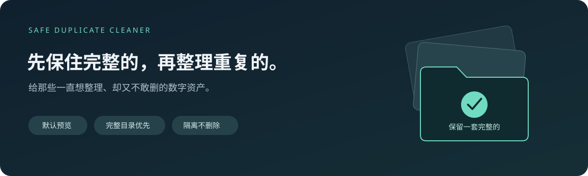

<div align="center">



# Safe Duplicate Cleaner

**Preserve complete project folders first, quarantine duplicate copies safely, and clean loose files without breaking simulation or code workspace dependencies.**

*A conservative, zero-data-loss duplicate cleaner built for engineers, researchers, and digital asset collectors who fear accidental deletion.*

**English** · [中文说明](#-中文说明)

**Python 3.10+ · Zero Dependencies · Preview First · Never Delete (Quarantine Only) · MIT**

</div>

---

## 💔 Does this sound like your digital storage?

- **"I keep buying external hard drives, creating backups of backups..."**  
  Working on simulations (ANSYS, COMSOL, MATLAB), software engineering, or media production generates massive amounts of data. When running out of space or switching devices, the quickest option is often a full copy-paste. Over time, drives stack up, each with incomplete, duplicate backups. Finding a specific project feels like digital archaeology.

- **"I don't dare to use commercial 'One-Click Cleaners'!"**  
  Standard duplicate cleaners compare files strictly by individual SHA-256 hashes across random folders. They break up complete simulation projects, code repositories, or design assets by deleting single files scattered across different directories, rendering entire projects unopenable.

- **"I need a 100% safety guarantee against accidental deletion."**  
  Your data is irreplaceable. If there's even a 0.01% chance of losing critical files, you'd rather let hard drives overflow. You need a tool that **previews by default, never permanently deletes, quarantines instead of erasing, and guarantees complete rollback traceability.**

---

## ✨ Why Safe Duplicate Cleaner?

| Feature | Standard Duplicate Cleaners | Safe Duplicate Cleaner |
| :--- | :--- | :--- |
| **Folder Protection** | Breaks folders apart, deleting single files randomly | **Prioritizes complete duplicate folders**; quarantines entire directory copies together |
| **Data Safety** | Permanent deletion / Recycles to bin | **Zero permanent deletion**; safely moves copies to a local quarantine area |
| **Execution Mode** | Cleans immediately | **Preview-only by default**; generates CSV / JSON reports before any action |
| **State Protection** | Ignores concurrent lock/file changes | **Safety trip-lock**; re-checks files before isolation & logs state in SQLite WAL |
| **Loose Files** | Indiscriminate global cleaning | Cleans loose files **only inside safe leaf directories** |

---

## 🛡️ Two-Level Conservative Strategy

```text
[Scan Root Folder]
  ├── 📁 Project_A (Copy 1) \___ 1️⃣ Level 1: Identified as Complete Duplicate Folder!
  ├── 📁 Project_A (Copy 2) /    👉 Quarantine [Project_A (Copy 2)] as a whole package!
  │                                 Never break up internal project configs or data!
  └── 📁 Logs Leaf Directory \___ 2️⃣ Level 2: Safe Leaf Directory
        ├── log_01.txt           👉 Clean loose duplicate files strictly inside
        └── log_01_copy.txt         leaf directories without subfolders
```

1. **Level 1: Outermost Complete Duplicate Folders First**  
   Folders with identical relative directory structures, file sizes, SHA-256 hashes, and empty folder layouts are recognized as complete duplicates. One copy is preserved (Keeper), while extra copies are moved as whole folders into quarantine.
2. **Level 2: Leaf Directory Loose File Cleaning**  
   Loose file cleaning is restricted to "leaf directories" (folders containing no subdirectories). Parent directories with subdirectories are protected from loose file removal.
3. **Cross-Directory Duplicates: Report Only**  
   Partially copied or incomplete folders are listed in reports but never merged or torn apart automatically.

---

## 🚀 Quick Start

### Requirements
- **Python 3.10+** (Runs entirely on standard library, no third-party packages required).
- Supports **Windows / macOS / Linux**.

### 1. Dual-Click Mode (Easiest)
1. Copy `两级重复文件安全清理.py` into the directory you want to clean.
2. Double-click to run. It defaults to preview mode, scans file size candidates, calculates SHA-256, and outputs a UTF-8 BOM CSV report (openable in Excel) under `_重复文件报告`.
3. Review the report. If satisfied, change `MOVE_DUPLICATES = False` to `True` at the top of the script and run again to perform quarantine.

### 2. Command Line Interface (CLI)

```powershell
# Preview Mode (Default, Safe & Non-destructive)
python "两级重复文件安全清理.py" "D:\MyData" --output "D:\Reports"

# Quarantine Mode (Explicitly Enabled)
python "两级重复文件安全清理.py" "D:\MyData" --output "D:\Reports" --apply
```

### 3. Graphical Interface (GUI) & Visual Web Viewer
- **Desktop GUI**: Run `python gui.py` for a Tkinter desktop window featuring real-time progress, thread isolation, and stale-path protection.
- **Web Report Viewer**: Open `viewer.html` in any browser and drag-and-drop the generated JSON report for an interactive dashboard.

---

<br/>

---

## 🇨🇳 中文说明

<div align="center">

# 盘越来越多，资料却越来越难找。

**又买了一块硬盘，复制了一遍。空间暂时够了，混乱也多了一份。**

Safe Duplicate Cleaner · 两级重复文件安全清理  
从不敢动的重复副本开始，让数字资产整理有一个可检查的起点。

</div>

### 💔 你是不是也有这些文件夹？

```text
旧电脑备份/
移动硬盘备份/
移动硬盘备份_新/
先别删/
整理完再删/
最终版/
最终版_真的最终版/
```

- **“硬盘买了一个又一个，里面全是‘备份的备份’……”**  
  做模拟、搞工程、做设计，数据和项目极多。因为太忙太累、时间有限，每次换设备或备份时，最快的方式就是全盘/整目录直接复制粘贴。久而久之，移动硬盘、U盘堆成山，盘盘都有备份，盘盘都不完整。

- **“根本不敢用市面上的‘一键清理大师’！”**  
  模拟工程（ANSYS、COMSOL、OpenFOAM、MATLAB）、代码仓库或设计项目，内部有严密的相对路径和配置文件。市面上的清理工具只会生硬地按单文件 SHA256 跨目录乱删，直接打散工程目录，导致仿真工程再也打不开。

- **“极度害怕误删，需要 100% 的‘后悔药’。”**  
  数字资产过于宝贵，你需要的是一个**只隔离、不删除、默认纯预览、断点增量续扫**的绝对安全工具。

---

### ✨ 核心特性

1. **增量扫描与断点续扫（SQLite 数据库索引 `cleaner_vault.db`）**  
   二次运行或中途中断再次扫描时，自动复用哈希缓存，不重复读取未修改的大文件，比对秒速完成。
2. **第一级：完整工程文件夹优先整包隔离（选项 A）**  
   相对文件结构、文件大小与 SHA-256 完全一致的文件夹，整体移入隔离区，绝不打散工程内部相对路径与配置文件。
3. **自动跳过回收站与系统保护区**  
   自动过滤 Windows `$RECYCLE.BIN`、`RECYCLER` 及 `System Volume Information`，避免已删除的垃圾文件误判污染。
4. **多样化交互**  
   支持双击即用、命令行 CLI、Tkinter 桌面 GUI (`gui.py`) 以及网页端暗黑风报告查看器 (`viewer.html`)。

---

## 🧪 Automated Test Suite

Tested against **32 comprehensive test cases** covering folder integrity, nested duplicates, partial copies, corrupt files, interrupted execution recovery, and SQLite journal safety:

```powershell
python test_safe_cleanup.py
```

See [测试报告.md](测试报告.md) for full details.

---

## 📄 License

This project is open-sourced under the [MIT License](LICENSE).
